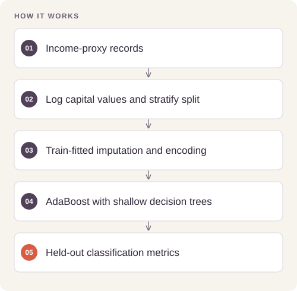

# Donor Prospect Classification

Compare classifiers for an income-based prospect-ranking proxy and make the precision–recall trade-off explicit.

## Implementation

A portable train-fitted numeric/categorical preprocessing pipeline and AdaBoost evaluation with accuracy, precision, recall, and F0.5.




## Train and reload the classifier

A new full UCI Adult run trains the income-proxy classifier with duplicate-feature-group-safe holdout, normalized UCI labels, missing-category handling and fitted-pipeline export. The 9,770-row holdout has85.74% accuracy and F0.5=0.7259.

[Commands, artifacts and benchmark scope](BENCHMARKS.md) · [Versioned profiles](reproduction.json)


## Try a small example

Generated records exercise preprocessing and fitting. Income is a proxy target in the original study; it does not measure charitable giving or donor response.

After the local setup below, run from the repository root:

```sh
python examples/quickstart.py
```

The [example source](examples/quickstart.py), [captured output](examples/expected-output.txt) and [execution record](examples/environment.json) keep this demonstration inspectable. Floating-point values may vary with library versions.

Observed output from this run:

```text
{
  "test_rows": 24,
  "accuracy": 1.0,
  "precision": 1.0,
  "recall": 1.0,
  "f0_5": 1.0
}
```

## Completed study

The saved optimized model reports test accuracy 0.8690, precision 0.7811, recall 0.6426, and F0.5 0.7489. Restricting the model to its five leading features reduces F0.5 to 0.6883.

These historical figures describe the completed study. This refactored standalone implementation has separate validation and has not been used to recertify the historical benchmark. The public release contains the portable core and focused tests.

## Run locally

Python 3.11 or later.

```sh
python -m venv .venv
source .venv/bin/activate
python -m pip install -r requirements.txt
python smoke_test.py
python prospect_model.py /path/to/census.csv
```

Prepare your own inputs as described in [DATA.md](DATA.md). Tests use generated fixtures and do not need credentials or provider calls. [VALIDATION.md](VALIDATION.md) records their scope.

## Practical relevance and limitations

Income is a proxy, not observed donation propensity or a measure of campaign lift. Demographic predictors require careful review before any targeting decision. Cross-validation operates on the training partition; the held-out comparison is a single experiment.

## Reuse

The original contributions listed in [LICENSING.md](LICENSING.md) are available under [MIT](LICENSE). This scoped grant preserves upstream notices and separate dataset, simulator, notebook and checkpoint terms.
